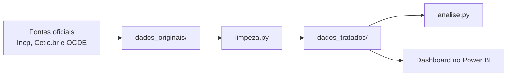

<h1 align="center">📚 Análise de Dados & BI: IA na Aprendizagem</h1>

<p align="center">
  Como vai o ensino médio no Brasil e como os alunos estão usando inteligência artificial para estudar,<br>
  a partir de dados oficiais do Inep, da Cetic.br e da OCDE.
</p>

<p align="center">
  
  
  
  
</p>

---

## 📌 Sobre o projeto

Este é o projeto final da disciplina de Análise de Dados e BI, do curso de Ciência da Computação.
A ideia é entender como anda o desempenho dos alunos do ensino médio e de que forma a IA entrou na rotina de estudos deles.

Fizemos o trabalho por partes. Começamos pelas perguntas e pelo jeito de medir cada uma, depois fomos atrás das fontes,
limpamos as bases e partimos para a análise. Por último, os resultados viram propostas.

## ❓ O que queremos responder

- Como está o desempenho no ensino médio e como ele mudou desde 2017?
- Com que frequência os alunos usam IA nos estudos?
- Para que eles usam?
- Quem usa mais tecnologia tira notas melhores ou piores?
- As escolas e os professores estão preparados para orientar esse uso?

## 💡 O que encontramos até agora

- O Ideb do ensino médio passou de 3,8 em 2017 para 4,5 em 2025. No Nordeste, foi de 3,5 para 4,3.
- 70% dos alunos do ensino médio que usam a internet já recorreram a ferramentas de IA em pesquisas e atividades da escola.
- Só 32% disseram que algum professor conversou com a turma sobre como usar IA nas atividades da escola, e só 28% das
  escolas que vão até o ensino médio têm um guia sobre o assunto.
- No Saeb, quem tem computador em casa tira 24,9 pontos a mais em Matemática. Comparando alunos do mesmo nível
  socioeconômico e da mesma rede, a diferença cai para 10,8 pontos. Isso mostra uma relação, mas não prova que o
  computador seja a causa.

## 🔄 Como funciona



1. Os arquivos das fontes ficam em `dados_originais/`, do jeito que foram baixados.
2. O `limpeza.py` trata cada base e anota tudo o que fez em `dados_tratados/registro_limpeza.csv`.
3. O `analise.py` compara nossos números com os que as fontes publicaram e responde às perguntas.
4. O dashboard lê as bases tratadas e mostra os resultados com filtros.

## 🗂️ Fontes de dados

| Fonte | Quem publica | O que usamos |
|---|---|---|
| [Ideb 2025](https://www.gov.br/inep/pt-br/areas-de-atuacao/pesquisas-estatisticas-e-indicadores/ideb/resultados/2005-2025) | Inep | Ideb, notas e aprovação por rede, região, estado e escola |
| [Saeb 2023](https://download.inep.gov.br/microdados/microdados_saeb_2023.zip) | Inep | Notas, nível socioeconômico, computador e Wi-Fi de cada aluno |
| [TIC Educação 2024 e 2025](https://cetic.br/pt/pesquisa/educacao/indicadores/) | Cetic.br | Uso de IA, conversa dos professores sobre IA, formação e regras das escolas |
| [TIC Kids Online Brasil 2025](https://cetic.br/pt/arquivos/kidsonline/2025/criancas/) | Cetic.br | Para que os alunos do ensino médio usam a IA |
| [Pisa 2025](https://www.oecd.org/en/data/datasets/pisa-2025-database.html) | OCDE | Frequência de uso de chatbots de IA e notas de acordo com cada resposta |

## 📁 Estrutura do repositório

```
📦 Analise-Dados-BI-IA-na-Aprendizagem
├── 📁 dados_originais/    arquivos como vieram das fontes
├── 📁 dados_tratados/     bases limpas, registro da limpeza e conferência
├── 📁 dashboard/          painel do Power BI (em construção)
├── 🐍 limpeza.py          limpa as bases e registra cada passo
├── 🐍 analise.py          confere os números e responde às perguntas
└── 📄 requirements.txt    bibliotecas usadas
```

## 🚀 Como rodar

Você vai precisar do Python 3.10 ou mais novo.

```bash
git clone https://github.com/rafaelmagnog/Analise-Dados-BI-IA-na-Aprendizagem.git
cd Analise-Dados-BI-IA-na-Aprendizagem
pip install -r requirements.txt
python limpeza.py
python analise.py
```

## 📊 Dashboard

🚧 Em construção. O painel ficará em `dashboard/` e abre no Power BI Desktop.

## 🛠️ Tecnologias

Python, pandas, NumPy, openpyxl, Matplotlib, statsmodels e Power BI.

## 👥 Autores

- Rafael Magno Guimarães Tabosa Braga
- Levi Adler Borges de Albuquerque
